# Trường học cửu chương

Game nhỏ cho các bạn tiểu học vừa chơi vừa học: luyện bảng cửu chương (bảng nhân 2–9, có thể bật thêm phép chia), học Toán, Khoa học, Tiếng Anh lớp 4 và kỹ năng sống (an toàn giao thông, ăn uống an toàn, phòng cháy chữa cháy, phòng đuối nước, an toàn ở nhà).
Bé tự tạo nhân vật mang tên mình, chào ông bà bố mẹ ở nhà, đeo ba lô đi dọc đường làng, chờ đèn xanh sang đường, qua cổng trường, vào lớp, lên bảng, rồi học và luyện qua các trò chơi.

**Chơi ngay: <https://congai.lamphong.info>**

Miễn phí, không quảng cáo, không cần đăng ký. Chạy trên trình duyệt của điện thoại, máy tính bảng và máy tính.
Game chỉ là các file tĩnh (HTML, CSS, JavaScript), không có máy chủ phía sau và không gửi dữ liệu đi đâu.

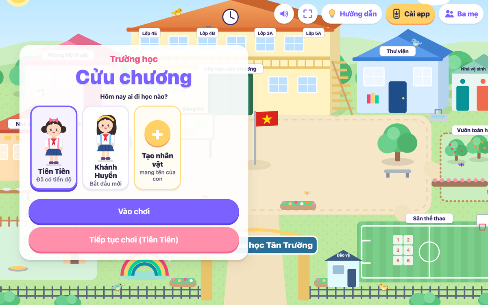

## Trong game có gì

| | |
| --- | --- |
| 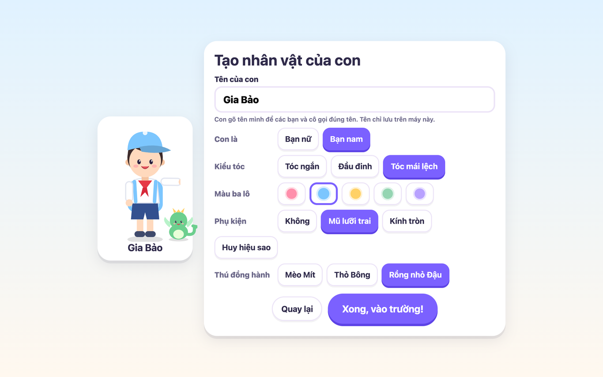 **Tự tạo nhân vật mang tên mình:** bạn nam hoặc bạn nữ, kiểu tóc, ba lô, thú đồng hành. | 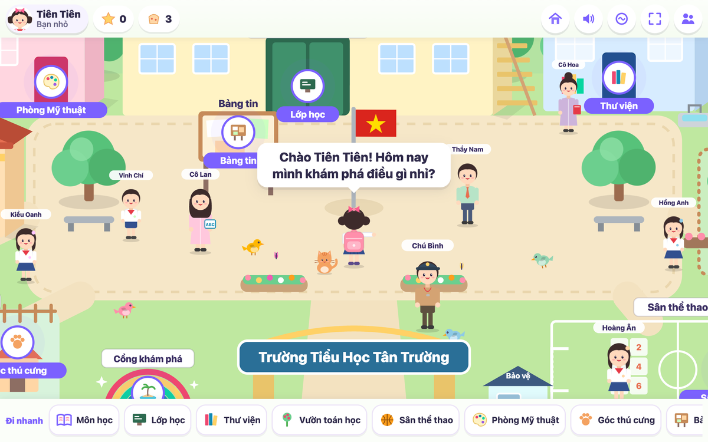 **Đi học:** bước qua cổng trong tiếng trống trường, dạo sân, gặp thầy cô và các bạn. |
| 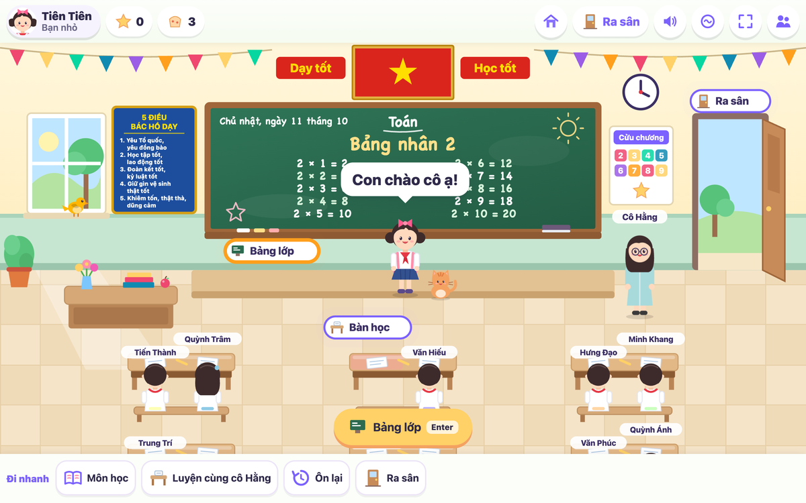 **Lớp học:** bảng xanh viết phấn, bục giảng, cô giáo và các bạn ngồi trong lớp. | 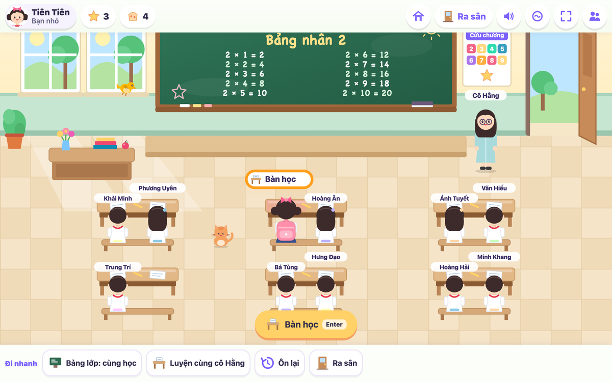 **Bàn học:** ngồi vào chỗ của mình để luyện cùng cô. |
| 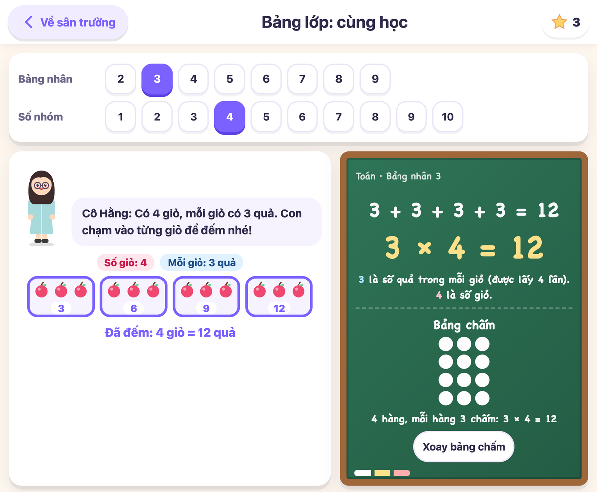 **Học bằng hình:** đếm từng nhóm đồ vật rồi mới ra phép cộng và phép nhân. | 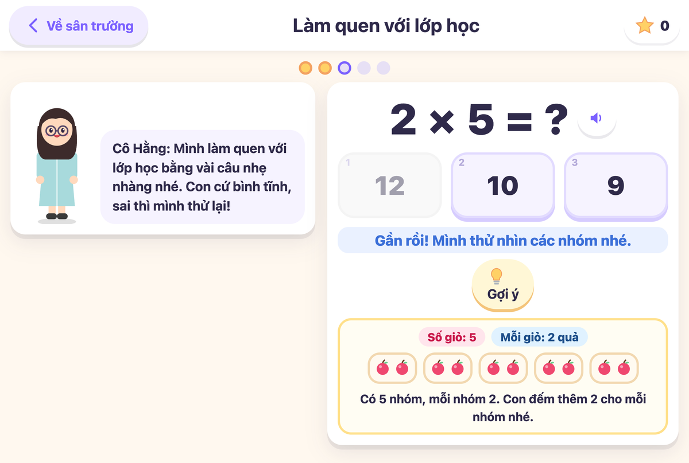 **Sai không bị trừ điểm:** game hiện hình gợi ý để bé tự tìm ra đáp án, câu sai được hỏi lại sau vài câu. |
| 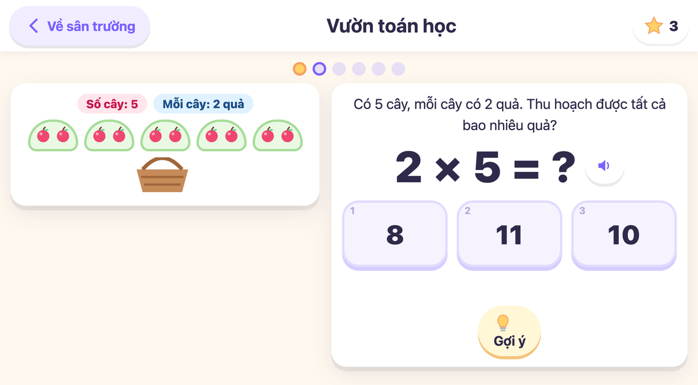 **Vườn toán học:** hái quả theo từng cây. | 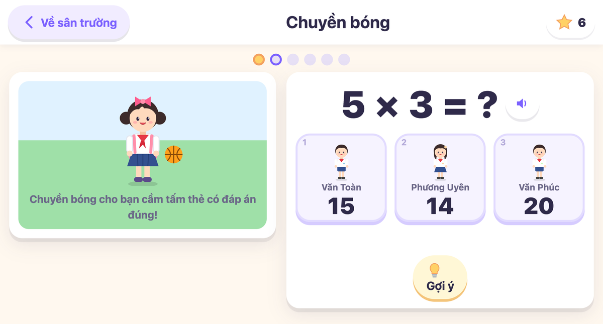 **Chuyền bóng:** chuyền cho bạn cầm đáp án đúng. |
| 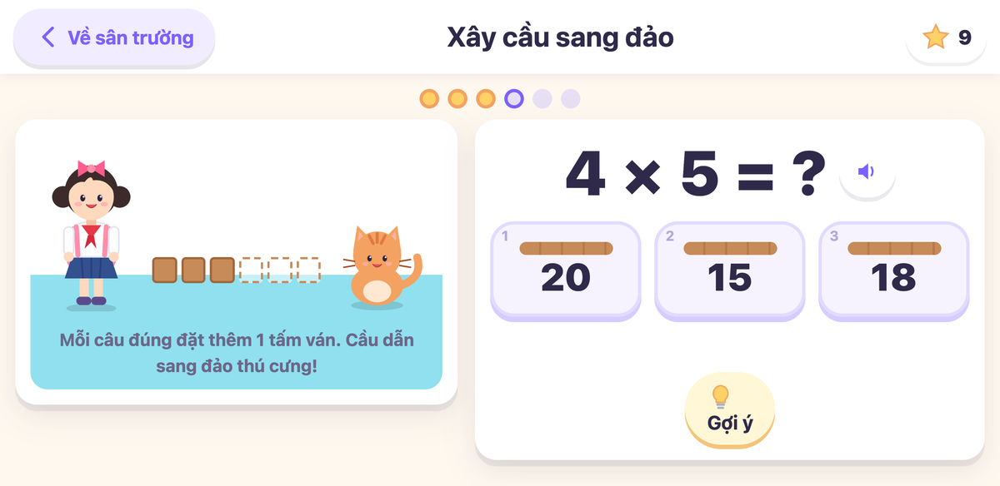 **Xây cầu:** mỗi câu đúng đặt thêm một tấm ván. | 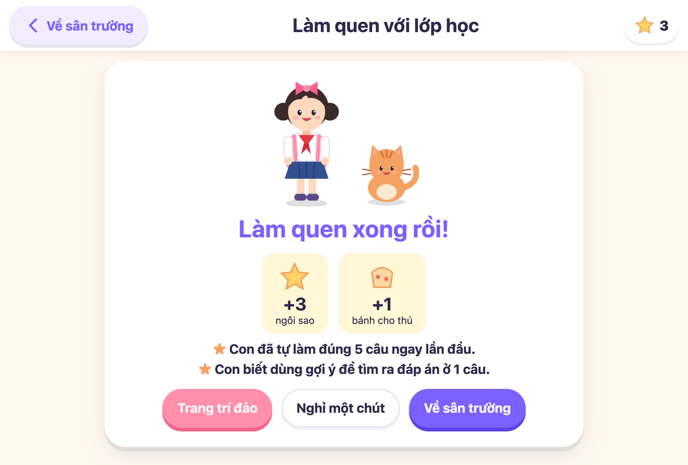 **Phần thưởng:** ngôi sao và bánh cho thú sau mỗi nhiệm vụ. |
| 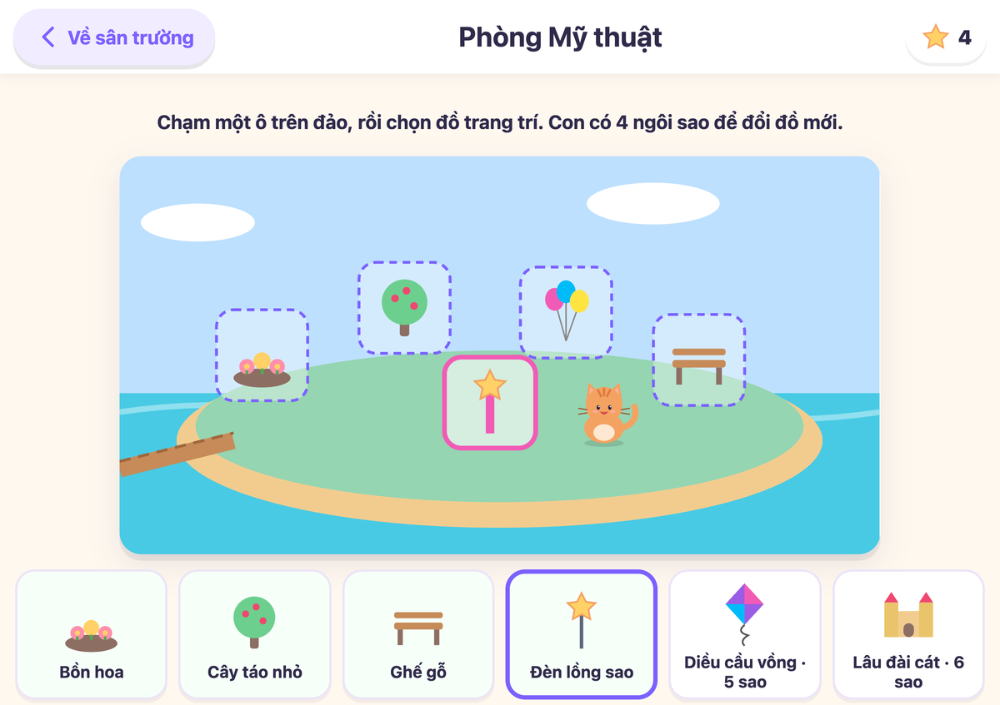 **Trang trí đảo:** đổi ngôi sao lấy đồ trang trí. | 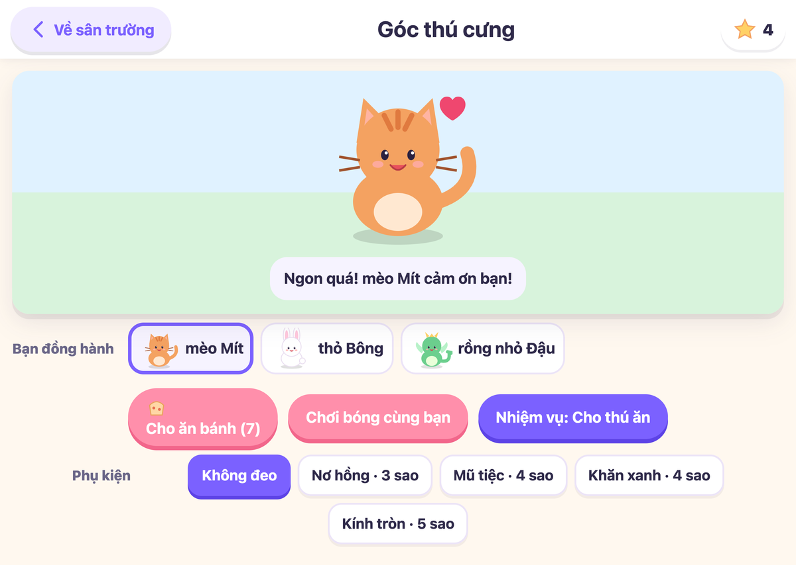 **Thú đồng hành:** mèo Mít, thỏ Bông, rồng nhỏ Đậu. |

Ngoài ra còn có thư viện ghép thẻ, bảng tin với nhiệm vụ mỗi ngày, và phần "Ôn lại" tự chọn những phép tính bé hay sai.

### Nhà em ở làng quê

Mỗi lần vào chơi, bé bắt đầu ở nhà: chào ông bà, bố mẹ rồi chạm **Đi học** ở cổng nhà để ra đường tới trường (ai vội thì bấm "Vào trường" ở thanh Đi nhanh). Ngôi nhà của bé có ông bà, bố mẹ, sân gạch phơi thóc, vườn rau, ao cá, chuồng gà, chuồng lợn, con bò, chó mèo và một khúc sông chảy qua. Mỗi nơi là một góc học để bé biết tự giữ an toàn:

| Nơi | Bé học gì | Ai dạy |
| --- | --- | --- |
| **Gian bếp** | Phòng cháy chữa cháy (26 câu), bảng "Khi có cháy, con nhớ", bảng số khẩn cấp 111, 113, 114, 115 | Mẹ |
| **Bờ sông, ao cá** | Phòng tránh đuối nước (19 câu), mưa bão và sấm sét (15 câu) | Bố |
| **Hiên nhà** | An toàn ở nhà: điện, thuốc, vật sắc nhọn, người lạ, chó cắn… (25 câu); gia đình em: xưng hô, lễ phép, việc nhà (16 câu) | Bà, ông |
| **Chuồng trại** | Vật nuôi trong nhà: gia cầm, gia súc, cách chăm và giữ vệ sinh (19 câu) | Bà |
| **Vườn rau** | Vườn nhà, đồng quê: cây trồng, mùa màng (18 câu) | Ông |

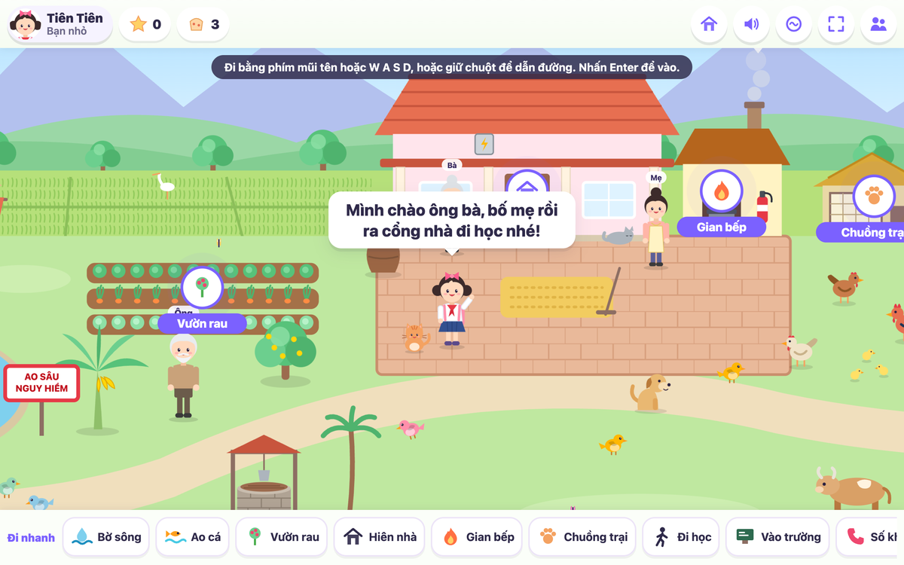

- **Cảnh báo nguy hiểm:** bé không lội xuống ao, xuống sông được. Lại gần mép sông, mép ao hay giếng thì bé được nhắc ngay vì sao chỗ đó nguy hiểm.
- **Chạm vào cảnh vật:** hơn 30 thứ có lời nói riêng, như bếp, bình chữa cháy, cầu dao điện, giếng, chum nước, cây rơm, con chó, gà vịt, phao cứu sinh, chiếc thuyền… Con vật có tiếng kêu.
- **Việc nhà vừa sức:** cho gà vịt ăn giúp bà, tưới rau giúp ông; mỗi việc được thưởng một ngôi sao một lần mỗi ngày.

| | |
| --- | --- |
| 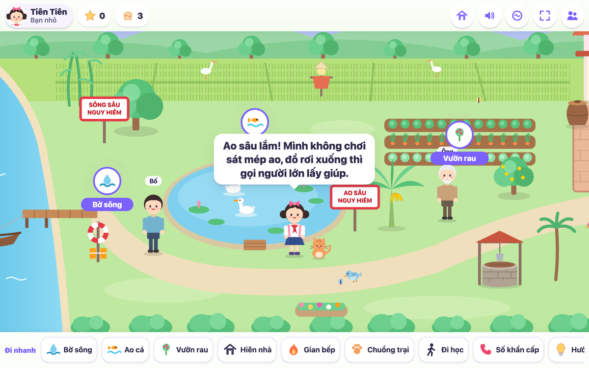 **Ao cá:** lại gần mép ao là được nhắc. | 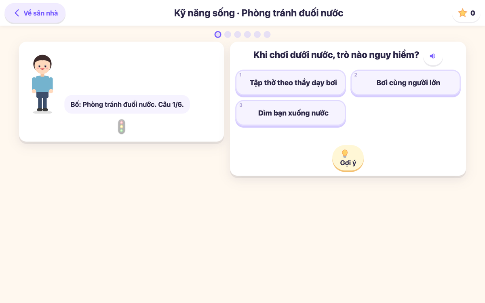 **Bờ sông:** bố dạy phòng tránh đuối nước. |
| 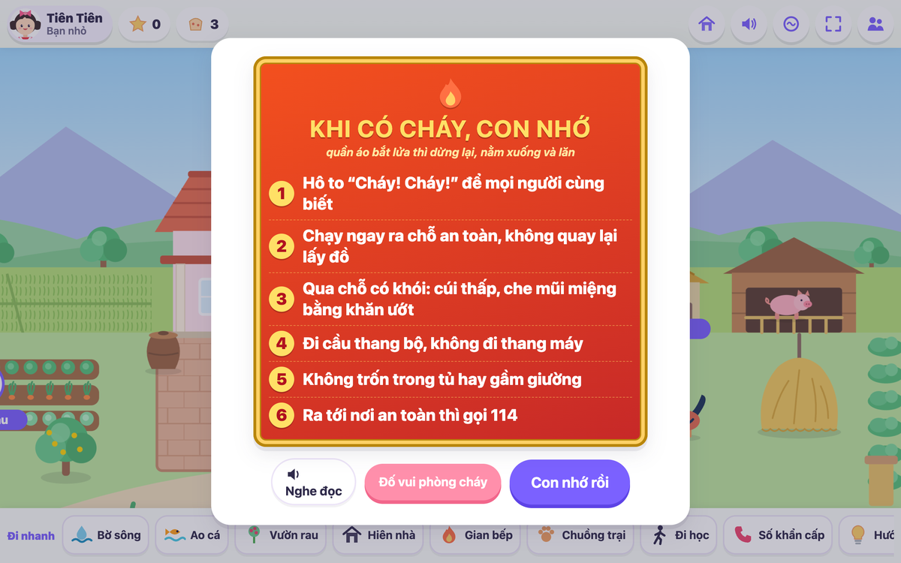 **Gian bếp:** sáu điều cần nhớ khi có cháy, có nghe đọc. | 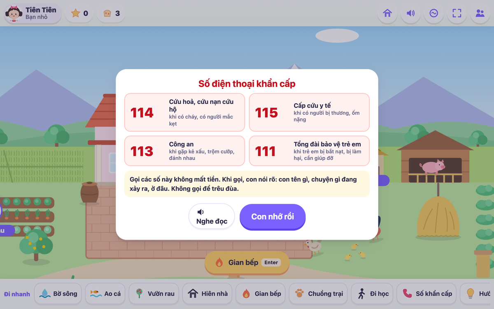 **Số khẩn cấp:** gọi số nào, khi nào, nói gì. |

Câu hỏi soạn theo các khuyến cáo phổ biến cho học sinh tiểu học, chưa qua thầy cô hay cơ quan chuyên môn thẩm định. Ba mẹ thấy câu nào chưa hợp thì sửa trong `js/bank-home.js`.

### Đường tới trường

Từ cổng nhà, bé đi dọc con đường làng: núi xa, đồng lúa, con trâu, đàn cò, làng xóm, rồi tới đoạn đường có xe cộ và đèn giao thông trước cổng trường.

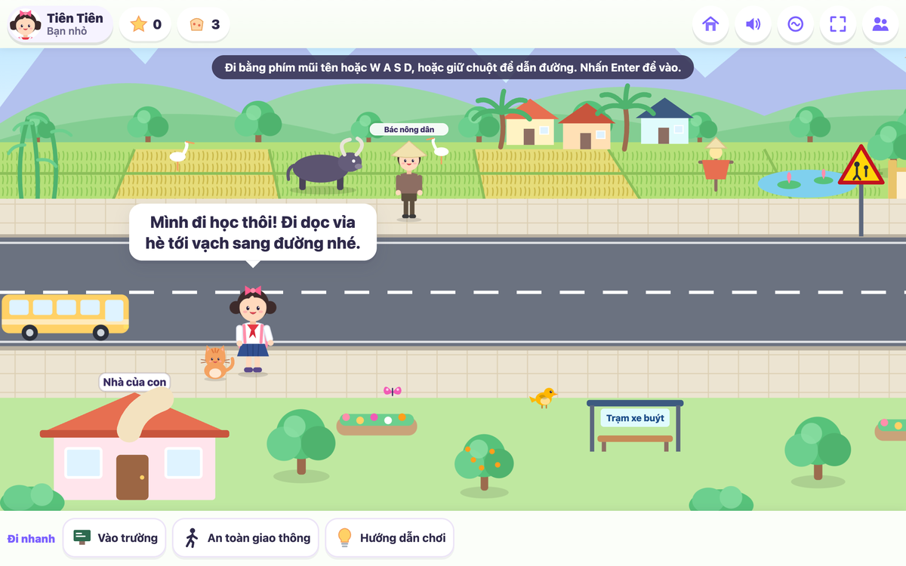

| | |
| --- | --- |
| 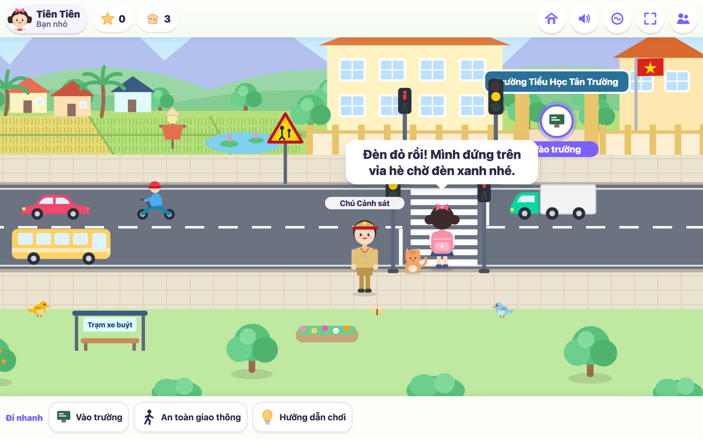 **Đèn đỏ:** bé đứng trên vỉa hè chờ, không bước xuống đường được. | 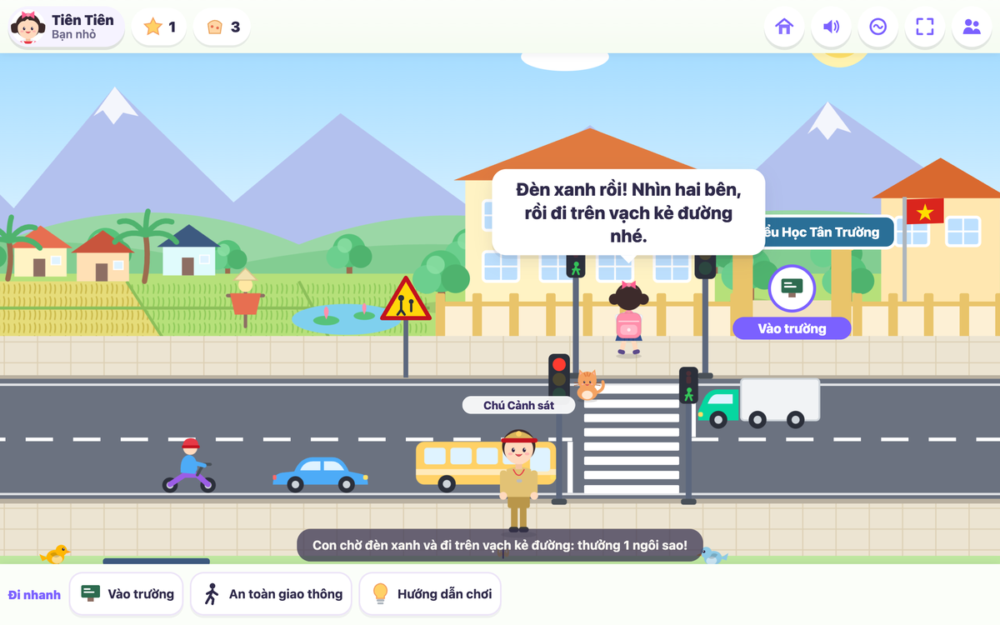 **Đèn xanh:** nhìn hai bên rồi đi trên vạch kẻ đường, xe dừng trước vạch. |

- **Đèn giao thông:** đèn cho người đi bộ đỏ thì bé không bước xuống đường được và được nhắc đứng chờ. Đèn xanh thì sang đường trên vạch kẻ. Xe cộ luôn dừng trước vạch khi bé còn ở trên đường. Sang đường đúng luật lần đầu mỗi ngày được thưởng một ngôi sao.
- **Chú Cảnh sát** dạy an toàn giao thông (22 câu), **bác nông dân** kể chuyện đồng ruộng.
- Từ sân trường có thể **ra đường** lại qua cổng; ai vội thì bấm "Vào trường" ở thanh Đi nhanh.
- Chạm **Về nhà** ở ngôi nhà đầu đường để quay lại cảnh "Nhà em".

### Tham quan trường

Chạm bảng **Sơ đồ trường** gần cổng (hoặc "Tham quan trường" ở thanh Đi nhanh): cô giáo dẫn bé đi lần lượt 10 điểm trong sân trường và kể vài câu ở mỗi nơi. Cuối chuyến là phần **Trường em, quê em** về xã Trường Lâm, tỉnh Thanh Hoá, kèm 12 câu đố vui.

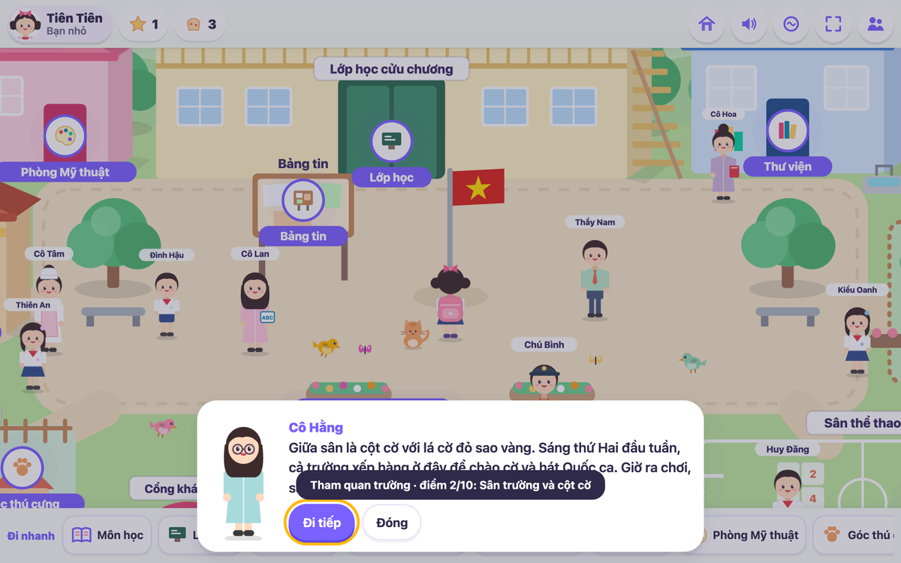

Ngôi trường trong game được vẽ theo tưởng tượng. Phần quê hương chỉ gồm thông tin đã đối chiếu với Wikipedia tiếng Việt (2024–2025). Thông tin riêng về trường thật (năm thành lập, số lớp…) chưa có nguồn công khai: ba mẹ, thầy cô thêm vào mục `SCHOOL` trong `js/tour.js` thì game sẽ hiện ra. Nhà khác dùng lại game thì sửa `js/tour.js` theo trường mình.

### Khám phá trong trường

- **Chạm vào cảnh vật:** lá cờ, cây, ghế đá, bồn hoa, đồng hồ, vòi rửa tay, thùng rác, con trâu, ao sen, biển báo… mỗi thứ có vài câu để bé đọc, mỗi lần chạm một câu khác.
- **Trò chuyện:** mỗi thầy cô và bạn học có 8–12 câu khác nhau.
- **Nhà ăn:** cô Tâm dạy ăn uống an toàn (22 câu): không ăn quà vặt không rõ nguồn gốc, xem hạn sử dụng, rửa tay, ăn đủ chất. Bật phép chia trong Góc ba mẹ thì có thêm trò chia phần bánh.
- **Phòng Mỹ thuật:** tô màu nhân vật (tóc, áo, váy hoặc quần, giày, ba lô, kiểu tóc, phụ kiện) và trang trí đảo.
- **Hướng dẫn chơi:** nút "Hướng dẫn" ở cổng trường và trong thanh Đi nhanh, có đọc thành tiếng.

| | |
| --- | --- |
| 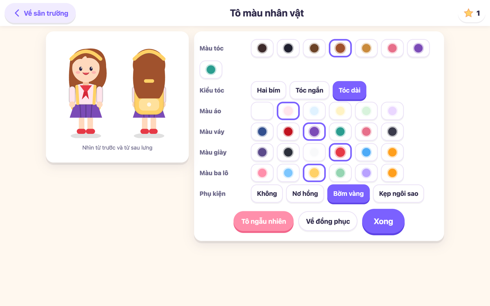 **Tô màu nhân vật:** nhìn từ trước và từ sau lưng, đổi màu là thấy ngay. | 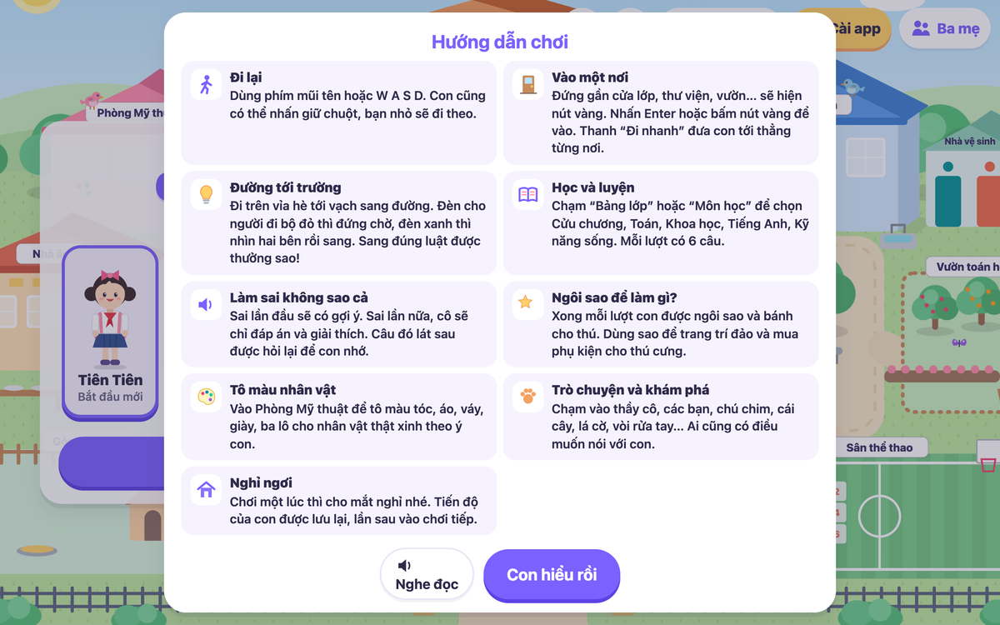 **Hướng dẫn chơi:** mười mục ngắn cho bé tự đọc hoặc nghe đọc. |

### Các môn học lớp 4

Bấm **Bảng lớp** trong lớp học hoặc nút **Môn học** ở thanh Đi nhanh để chọn môn. Nội dung soạn theo Chương trình giáo dục phổ thông 2018.

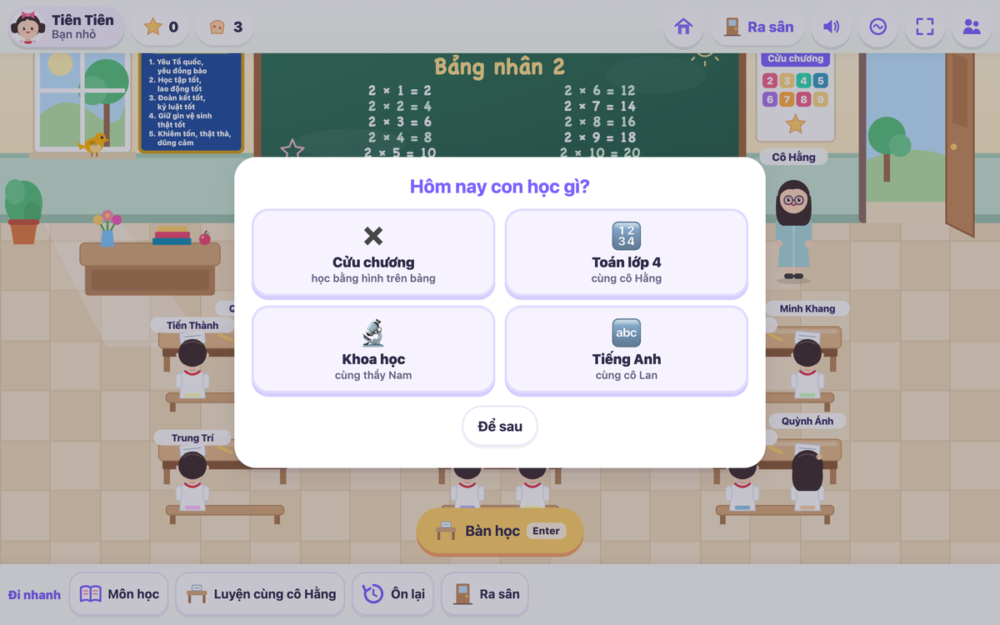

| Môn | Nội dung |
| --- | --- |
| **Toán lớp 4** (cô Hằng) | 8 chủ đề: số có nhiều chữ số, cộng trừ số lớn, nhân chia, trung bình cộng và tổng–hiệu, phân số, đo lường, hình học, biểu thức và tìm số chưa biết. Đề sinh ngẫu nhiên nên làm mãi không trùng. |
| **Khoa học** (thầy Nam) | 146 câu, 8 chủ đề: nước, không khí, ánh sáng và âm thanh, nhiệt, thực vật và động vật, nấm, dinh dưỡng và sức khoẻ, chuỗi thức ăn. |
| **Kỹ năng sống** | 194 câu, 10 chủ đề: an toàn giao thông, ăn uống an toàn, trường em quê em, và 7 chủ đề học ở cảnh "Nhà em". |
| **Tiếng Anh** (cô Lan) | 218 câu, 12 chủ đề theo sách Global Success 4, có máy đọc tiếng Anh và câu nghe (cần thiết bị có giọng đọc tiếng Anh). |

Mỗi lượt 6 câu trắc nghiệm. Sai lần đầu có gợi ý, sai lần hai được chỉ đáp án kèm giải thích, và câu đó sẽ được hỏi lại. Câu mới và câu từng sai được ưu tiên ở các lượt sau.

| | |
| --- | --- |
| 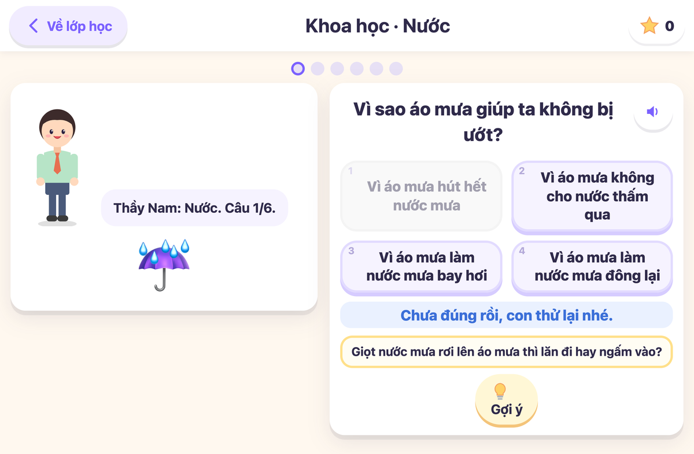 **Khoa học:** trả lời sai thì có gợi ý để nghĩ tiếp. | 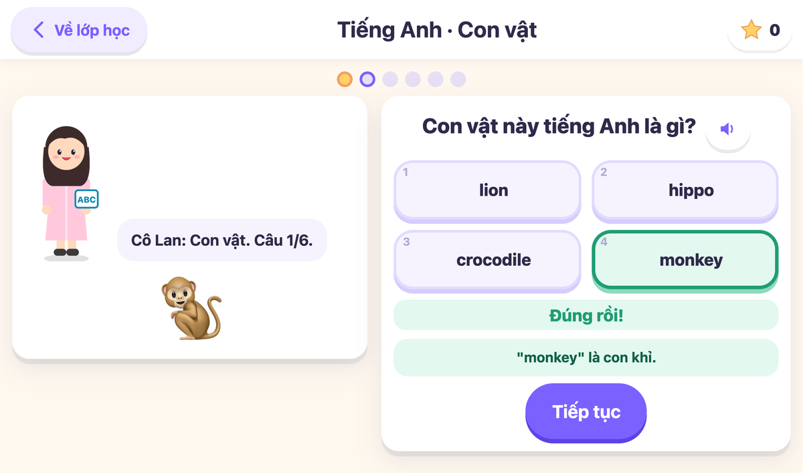 **Tiếng Anh:** trả lời xong máy đọc từ, câu tiếng Anh cho bé nghe. |
| 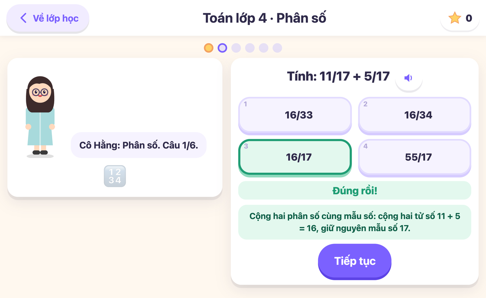 **Toán lớp 4:** mỗi câu có lời giải thích cách làm. | 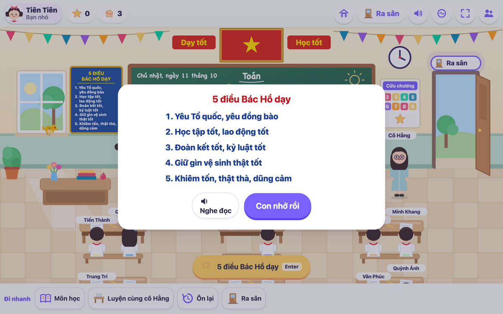 **5 điều Bác Hồ dạy:** chạm vào bảng trên tường lớp để đọc chữ to và nghe đọc. |

Phía trên bảng lớp có một bức tranh trong khung. Bản trong repo này treo lá cờ (`img/tranh-mac-dinh.svg`); muốn treo ảnh của nhà mình thì đặt một file tên `img/lop-hoc-tranh.jpg` (ảnh ngang, tỉ lệ khoảng 2:1) vào thư mục `img/`, game sẽ tự dùng ảnh đó. Chạm vào tranh để xem to.

## Cài game ra màn hình chính

Cài một lần, sau đó bé chỉ cần chạm vào biểu tượng **Cửu chương** là vào chơi: toàn màn hình, không có thanh địa chỉ, và chơi được cả khi không có mạng.

Cách nhanh nhất: mở game rồi bấm nút vàng **Cài app** ở góc trên màn hình cổng trường. Nút tự nhận biết loại máy; máy nào không cài tự động được thì nút hiện hướng dẫn từng bước cho đúng máy đó.

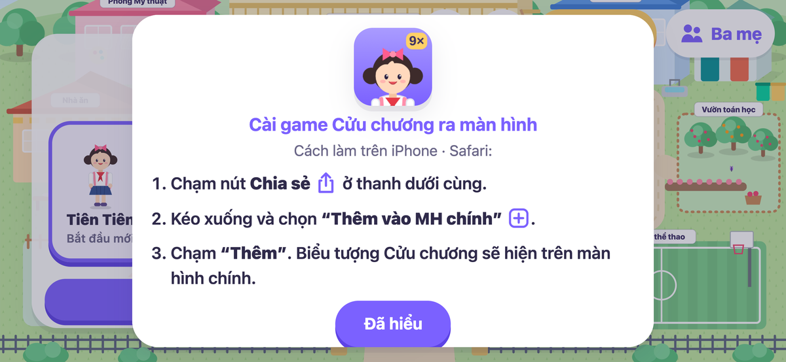

Nếu muốn tự làm bằng tay:

| Thiết bị | Cách cài |
| --- | --- |
| **iPhone, iPad** (Safari) | Chạm nút **Chia sẻ** (hình vuông có mũi tên lên) → **Thêm vào MH chính** → **Thêm** |
| **Android** (Chrome) | Chạm dấu **⋮** ở góc trên bên phải → **Thêm vào màn hình chính** (có máy ghi **Cài đặt ứng dụng**) → **Cài đặt** |
| **Samsung Internet** | Chạm nút menu **≡** → **Thêm trang vào** → **Màn hình chờ** |
| **Máy tính** (Chrome, Edge) | Bấm biểu tượng cài đặt ở cuối thanh địa chỉ → **Cài đặt** |
| **Máy Mac** (Safari 17 trở lên) | Menu **Tệp** → **Thêm vào Dock…** |

Lưu ý:

- **Mở link từ Facebook, Messenger, Zalo…** thì game sẽ thử tự chuyển sang Safari/Chrome. Nếu không tự chuyển được, game hiện bảng nhắc có nút "Mở bằng trình duyệt". Trong các ứng dụng đó không cài được và dễ mất tiến độ.
- **Trên iPhone, iPad nên cài trước rồi mới cho bé chơi.** Bản đã cài lưu tiến độ riêng, tách khỏi Safari.
- Firefox trên máy tính không cài được trang web thành ứng dụng; hãy dùng Chrome hoặc Edge.

## Cách điều khiển

- **Máy tính:** phím mũi tên hoặc `W A S D` để đi; hoặc nhấn giữ chuột, nhân vật đi theo con trỏ (nhấp một lần là đi tới điểm đó). Đứng gần một nơi hay một người rồi nhấn `Enter` để vào.
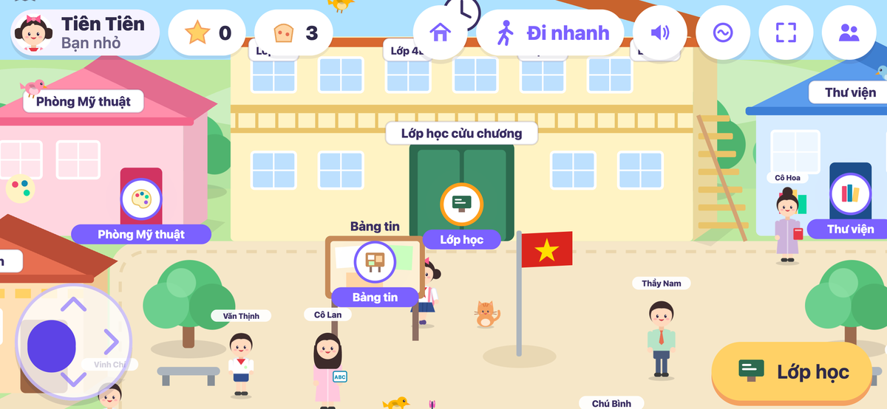

- **Chơi ngang màn hình:** game thiết kế cho màn hình ngang. Điện thoại, máy tính bảng đang cầm dọc sẽ được nhắc xoay ngang (vẫn có nút "Cứ chơi dọc" cho máy bị khoá xoay); bản đã cài trên Android tự mở ngang. Trên điện thoại cầm ngang, thanh "Đi nhanh" gom vào một nút ở thanh trên để nhường chỗ cho bản đồ.
- **Điện thoại, máy tính bảng:** vòng tròn điều hướng ở góc trái dưới (giữ và nghiêng về hướng muốn đi), nút vàng ở góc phải dưới để vào nơi đang đứng gần. Cũng có thể chạm vào nơi muốn tới, hoặc kéo để xem bản đồ.
- Thanh **Đi nhanh** ở dưới cùng đưa bé tới thẳng từng khu.

## Dành cho ba mẹ

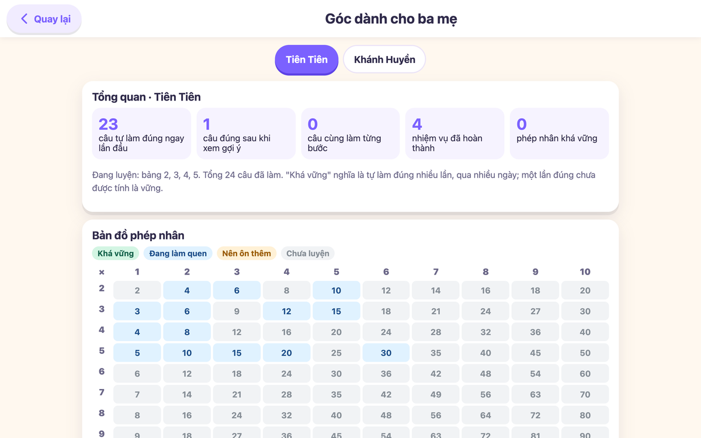

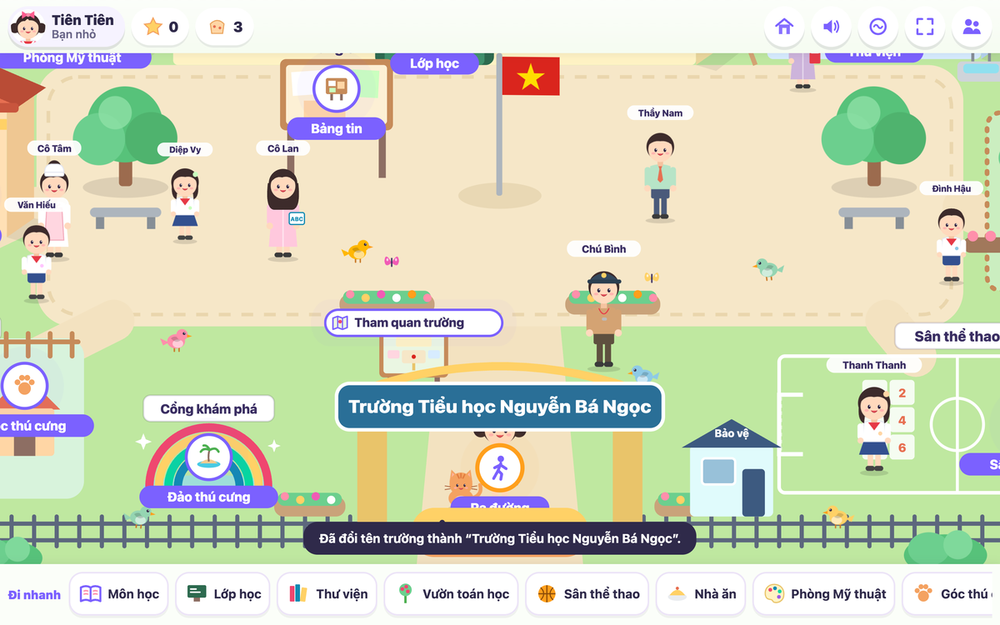

- **Đổi tên trường:** trong Góc ba mẹ có ô "Tên trường của con". Ba mẹ gõ tên trường con đang học, biển trên cổng trường và lời cô giáo trong chuyến tham quan sẽ dùng tên đó. Khi dùng tên riêng, phần "Trường em, quê em" (kể về xã Trường Lâm) được ẩn đi.
- **Góc ba mẹ** (nhấn giữ nút 2 giây để vào): xem bé đã vững phép tính nào, cần ôn phép nào; chọn bảng muốn luyện, thời lượng mỗi lượt, bật phép chia, tắt nhạc nền; xóa tiến độ hoặc xóa nhân vật.
- **Tiến độ lưu ngay trên máy của bé** (localStorage), riêng cho từng nhân vật. Vì vậy chơi trên máy khác sẽ bắt đầu lại, và xóa dữ liệu trình duyệt thì mất tiến độ.
- Game tự nhắc nghỉ khi bé chơi đủ thời lượng ba mẹ đặt.

## Tự làm bản riêng cho con

Bạn được tự do tải về, sửa và đăng lại (xem [Giấy phép](#giấy-phép)).

### Tải về và chạy thử

1. Bấm **Code → Download ZIP** ở đầu trang này rồi giải nén (hoặc `git clone`).
2. Mở file `index.html` bằng Chrome, Edge hoặc Safari là chơi được ngay.
3. Muốn thử cả phần cài app và chơi offline thì chạy qua một máy chủ nhỏ: trong thư mục game gõ `python3 -m http.server 8000` rồi mở `http://localhost:8000`.

### Đổi tên các bạn, cô giáo, trường

Tên trong bản này là tên các bạn cùng lớp của con mình. Để đổi thành lớp của con bạn:

| Muốn đổi | Sửa ở đâu |
| --- | --- |
| Tên các bạn trong lớp | Danh sách `CLASSMATES` ở đầu `js/storage.js` |
| Bạn nào là nam (để vẽ đúng hình) | Danh sách `BOYS` trong `js/art.js`; ai không có trong đó sẽ vẽ hình bạn nữ |
| Hai nhân vật có sẵn | `CHARACTERS` trong `js/storage.js` |
| Tên cô giáo | Tìm và thay chữ `Hằng` trong các file ở `js/` |
| Câu hỏi Khoa học, Tiếng Anh, Kỹ năng sống | Thêm, sửa các câu trong `js/bank-science.js`, `js/bank-english.js`, `js/bank-life.js`, `js/bank-home.js` (mỗi câu gồm câu hỏi `q`, đáp án đúng `a`, các đáp án sai `wrong`, lời giải thích `why`) |
| Thầy cô, chú bảo vệ ngoài sân | Danh sách `NPCS` trong `js/world.js`; lời thoại ở `npcLines` trong `js/activities.js` |
| Chuyến tham quan, phần quê hương | `STOPS`, `HOME`, `SCHOOL` trong `js/tour.js` |
| Tên trường trên cổng | Không cần sửa mã: đổi trong Góc ba mẹ. Tên mặc định là `DEFAULT_SCHOOL` trong `js/storage.js` |
| Ông bà, bố mẹ ở nhà | Danh sách `HOME_NPCS` trong `js/world.js`; lời thoại ở `npcLines` trong `js/activities.js` |
| Biển tên các lớp | Tìm `Lớp 4E` trong `js/art.js` |

Mỗi ngày game chọn ngẫu nhiên 4 bạn đứng ngoài sân và 10 bạn ngồi trong lớp từ danh sách, nên danh sách cần ít nhất 15 tên.

### Đưa lên mạng

Game chỉ gồm file tĩnh nên đặt ở đâu cũng được, miễn là có **https** (cần cho cài app và chơi offline).

- **GitHub Pages (miễn phí):** bấm **Fork** repo này → vào **Settings → Pages** → mục *Branch* chọn `main`, thư mục `/ (root)` → **Save**. Vài phút sau game chạy ở `https://<tên-tài-khoản>.github.io/<tên-repo>/`.
- **Hosting hoặc máy chủ riêng:** chép `index.html`, `manifest.webmanifest`, `sw.js` và bốn thư mục `css/`, `js/`, `icons/`, `img/` vào thư mục web.

Hai việc cần nhớ khi tự đăng:

- **Mỗi lần sửa file, tăng số phiên bản ở hai chỗ:** `CACHE` ở đầu `sw.js` (ví dụ `tientien-v12` → `tientien-v13`) và số `?v=` trong `index.html` (tìm `?v=12`, thay tất cả thành `?v=13`). Nếu không, máy đã mở game trước đó vẫn chạy bản cũ.
- **Game tự cập nhật:** vì game được lưu sẵn trong máy để chơi offline, mỗi lần mở lại (và mỗi 30 phút khi đang mở) trang sẽ hỏi máy chủ xem có bản mới. Có bản mới thì game tự tải lại ở màn hình cổng trường; nếu bé đang chơi dở, game chờ tới khi bé về cổng trường rồi mới cập nhật, tiến độ không mất.
- Đổi tên miền trong các thẻ `og:url` và `og:image` ở đầu `index.html` thành địa chỉ của bạn, để link chia sẻ lên mạng xã hội hiện đúng ảnh.

## Cấu trúc mã nguồn

Không dùng thư viện ngoài, không cần bước build. Hình vẽ là SVG tự vẽ, âm thanh tạo bằng WebAudio, nên cả game không có file ảnh hay file nhạc nào ngoài biểu tượng.

- `index.html`, `css/style.css`
- `js/engine.js` — toán, theo dõi từng phép tính, lập lịch ôn tập (Leitner), giải thích từng bước
- `js/storage.js` — hồ sơ riêng cho từng nhân vật (hai bạn có sẵn và các nhân vật bé tự tạo, tối đa 8), danh sách bạn cùng lớp
- `js/art.js` — toàn bộ hình vẽ: sân trường, lớp học, nhân vật nhìn từ trước và sau, thú, chim, đồ vật
- `js/art-home.js` — hình vẽ cảnh "Nhà em": bờ sông, ao cá, vườn rau, nhà và gian bếp, chuồng trại, vật nuôi
- `js/audio.js` — hiệu ứng, tiếng chim, tiếng vật nuôi và âm thanh nền theo cảnh, giọng đọc tiếng Việt
- `js/world.js` — các cảnh đi lại được (nhà em, đường tới trường, sân trường, lớp học): bàn phím, chuột, nút điều hướng, vật cản, tìm đường, xe cộ và đèn giao thông, nhắc khi tới gần chỗ nguy hiểm, cảnh vật chạm vào được
- `js/quiz.js` — bộ chạy nhiệm vụ, gợi ý hai mức, hỏi lại câu sai
- `js/tour.js` — nội dung chuyến tham quan trường và phần quê hương em
- `js/subjects.js` — các môn học lớp 4: chọn câu, chạy lượt trắc nghiệm, ghi tiến độ
- `js/bank-math.js`, `js/bank-science.js`, `js/bank-english.js`, `js/bank-life.js` — ngân hàng câu hỏi Toán (sinh đề ngẫu nhiên), Khoa học, Tiếng Anh, Kỹ năng sống (an toàn giao thông, ăn uống an toàn)
- `js/bank-home.js` — Kỹ năng sống ở nhà: phòng cháy chữa cháy, phòng đuối nước, an toàn ở nhà, vật nuôi, vườn nhà, gia đình em, mưa bão sấm sét
- `js/activities.js` — bảng lớp, thư viện, bảng tin, tô màu nhân vật, trang trí đảo, thú cưng, hướng dẫn chơi, lời thoại
- `js/visual.js` — hình nhóm đồ vật và bảng chấm
- `js/install.js` — nút "Cài app" cho từng loại thiết bị
- `js/external.js` — chuyển sang trình duyệt thật khi link được mở trong Facebook, Zalo…
- `js/parent.js` — góc ba mẹ
- `js/app.js` — điều phối màn hình và luồng chơi
- `manifest.webmanifest`, `sw.js`, `icons/` — cài app, chơi offline và tự cập nhật
- `img/` — tranh treo trong lớp

## Quy ước phép nhân

Theo sách giáo khoa Việt Nam: `a × b` nghĩa là "a được lấy b lần", tức b nhóm, mỗi nhóm a đồ vật (ví dụ 4 × 3 = 4 + 4 + 4 = 12).
Bảng chấm hàng/cột cho bé thấy 4 × 3 và 3 × 4 cùng bằng 12.

## Giấy phép

[MIT](LICENSE): dùng, sửa, chia sẻ lại thoải mái, chỉ cần giữ dòng ghi nguồn.

Ngôi trường trong game là bối cảnh tưởng tượng, không tái hiện kiến trúc của trường nào ngoài đời.
